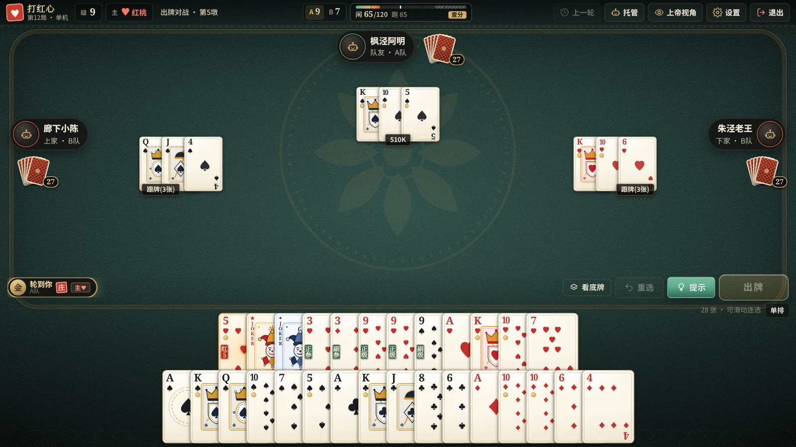
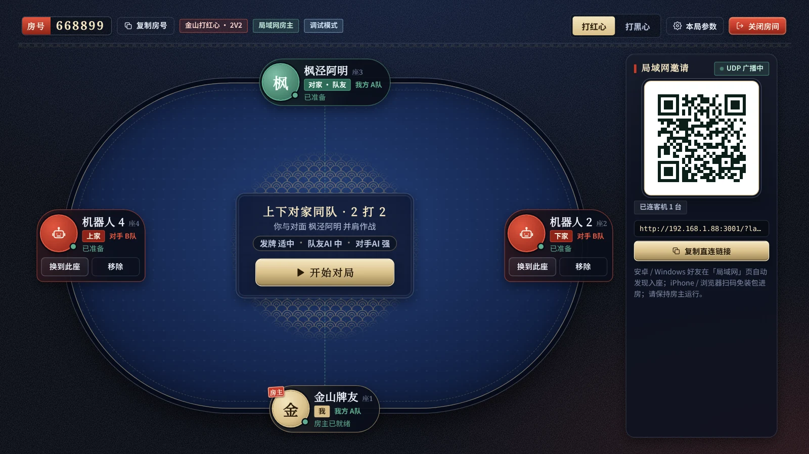
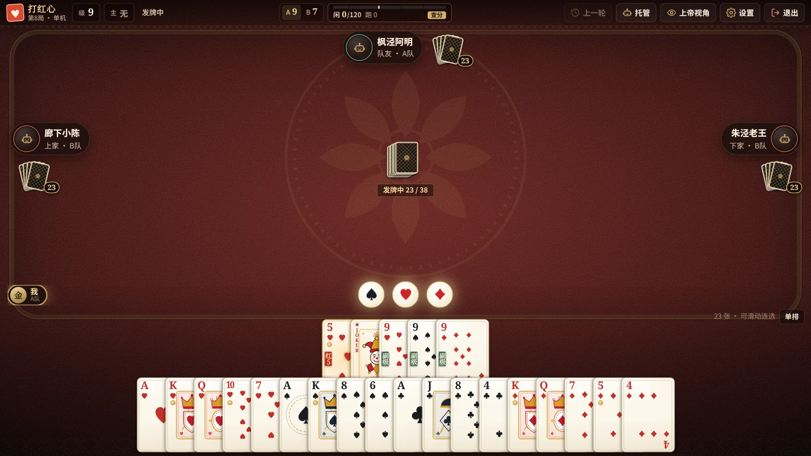
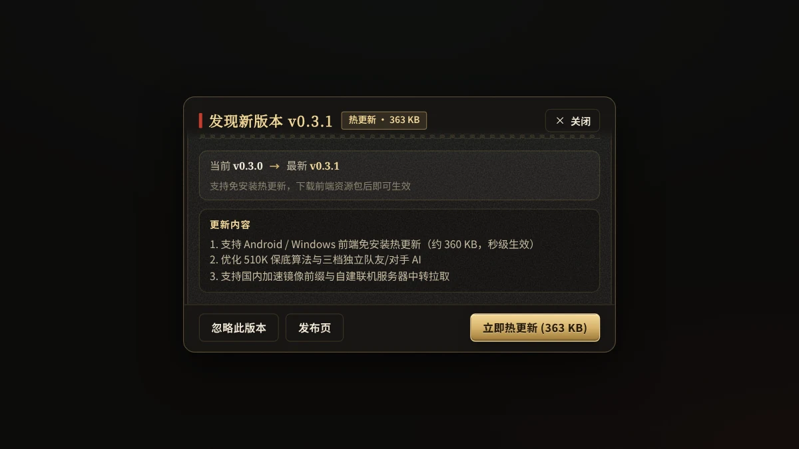

<div align="center">


# 金山打红心 · 打黑心

**上海金山特色三副牌扑克双模式游戏 · 支持 Android / Windows / Web 全端游玩**

[](https://github.com/ghost0211/JinShanHongXin/releases/latest)
[](#下载与安装)
[](packages/game-core)
[](apps/windows/README.md)

[核心亮点](#核心亮点) · [实机界面预览](#界面预览) · [下载与安装](#下载与安装) · [快速开发与构建](#快速开发与构建) · [自动发版与热更新](#自动发版与热更新) · [规则文档](docs/rules.md)

</div>

<br />



---

## 核心亮点

### 1. 正宗上海金山三副牌双模式
- **金山打红心（2 打 2 升级）**：完整还原 3 副牌 162 张（每人 38 张 + 10 张底牌）、**红心 5 最大**、正副参谋、发牌亮主与 **21 张比牌反主**、主副 `510K`、拖拉机、三拖拉机、甩牌校验、**`A=1` 低端连牌**、抠底 ×2 与反主惩罚抵消规则。
- **金山打黑心（1 打 3 叫分独斗）**：固定打 10、100~300 分阶梯叫分抢庄、定主、禁埋 10 点牌与庄闲攻防算分。

### 2. 三种联网形态，开箱即玩
- **纯离线单机人机**：内置 Web Worker 权威规则与 AI 引擎，无网或飞行模式也能 0 延迟秒开，自动保存本机战绩。
- **免服务器局域网面联**：Android APK 与 Windows 桌面端均内置零依赖 HTTP + WebSocket 房主服务与 **UDP（端口 30019）自动发现**；一键建房后生成直连二维码，安卓、Windows 或 iPhone/平板浏览器扫码即入座，**安卓与 Windows 互通**。
- **在线联机房服**：基于 Node.js + WebSocket + `node:sqlite`，支持邀请码注册、战绩排行榜、断线宽限保护、重连快照恢复与托管代打。

### 3. 三档独立可调的高水平 AI
- **队友 / 对手独立分档**：开局前在「本局参数」弹窗（以及候客室房主微调面板）中，可为**队友机器人**与**对手机器人**分别设置 **`低 / 中 / 强`** 三档难度，以及 **5 档发牌速度**（慢 / 较慢 / 适中 / 较快 / 极速）。
- **实战牌理优化**：强档内置采样前瞻搜索（PIMC），具备三家上大护分、送分给空门队友、防对手主牌 `510K` 抠底的保底埋底策略与残局收尾计算。

### 4. 新中式海派美学 & 全端交互
- **三套海派牌桌皮肤**：**墨韵黛青**、**朱漆描金**、**青花瓷蓝**，配金山农民画平涂小鱼结算印章、红5/正副参谋/级牌角标与分牌金色圆点。
- **离线原声质感音效与配乐**：内置 3 首零外链合成茶室背景音乐（**江南丝竹**、**海派雅韵**、**幽兰清茶**）与拟真发牌/出牌/拖拉机连击音效。
- **移动端 & PC 端深度适配**：手机横屏防遮挡布局、滑动区间连选、居中纯花色亮主按钮；Windows 客户端内置单实例保护、后台任务栏闪烁提醒、系统托盘、`F1` 快捷键面板与鼠标右键/双击出牌。
- **混合热更新**：Android 与 Windows 客户端均支持**免安装前端热更新**（下载约 360 KB 资源包，SHA-256 校验通过后秒级生效，并带防变砖自动回滚）；支持国内加速镜像前缀与自建联机服务器中转。

---

## 界面预览

<table>
  <tr>
    <td width="50%" align="center">
      
      <sub><b>海派大厅</b> · 单机 / 局域网 / 联机三模式与本机战绩</sub>
    </td>
    <td width="50%" align="center">
      
      <sub><b>青花瓷蓝候客室</b> · 透视四座、共享参数条与局域网扫码直连</sub>
    </td>
  </tr>
  <tr>
    <td width="50%" align="center">
      
      <sub><b>朱漆描金皮肤</b> · 发牌阶段居中纯花色亮主</sub>
    </td>
    <td width="50%" align="center">
      
      <sub><b>本局结算</b> · 金山农民画小鱼印章、升级走势与 10 张亮底</sub>
    </td>
  </tr>
  <tr>
    <td width="50%" align="center">
      
      <sub><b>本局参数弹窗</b> · 玩法、5 档发牌速度与队友/对手 AI 独立配置</sub>
    </td>
    <td width="50%" align="center">
      
      <sub><b>混合热更新</b> · 自动检查新版、360 KB 秒级热更与镜像/中转容错</sub>
    </td>
  </tr>
</table>

---

## 下载与安装

前往 [**GitHub Releases 最新版本页**](https://github.com/ghost0211/JinShanHongXin/releases/latest) 直接下载对应平台客户端：

| 平台 | 下载产物 | 说明 |
|---|---|---|
| **Android 手机 / 平板** | `jinshan-hongxin-v*.apk` | 约 450 KB，支持 Android 8.0+，沉浸式横屏 + 原生局域网建房 + 免安装热更新 |
| **Windows 安装版（推荐）** | `jinshan-hongxin-windows-v*-setup.exe` | 约 1.7 MB，Tauri 2 + WebView2，免管理员安装 + 原生局域网 + 免安装热更新 |
| **Windows 绿色免安装版** | `jinshan-hongxin-windows-v*-portable.zip` | 解压双击即玩，自带使用说明 |
| **iOS / 任意浏览器（PWA）** | 打开联机服或局域网房主二维码链接 | 免装包即开即玩，支持「添加到主屏幕」全屏体验 |

> [!TIP]
> 安装 `v0.3.0` 及以上版本后，后续规则、AI、界面和音效更新均支持在客户端内**一键免安装热更新**；如国内网络直连 GitHub 较慢，可在「游戏设置 → 版本与热更新」中填写加速镜像前缀（如 `https://ghfast.top`），或连接自建联机服务器自动中转拉取。

---

## 项目结构

| 路径 | 职责说明 |
|---|---|
| [`packages/protocol`](packages/protocol) | 前后端共享 WebSocket 协议、房间摘要与脱敏牌桌视图类型 |
| [`packages/game-core`](packages/game-core) | 纯函数权威规则引擎、`510K` / 甩牌校验、三档 Bot AI 与 `LocalHostController` |
| [`apps/server`](apps/server) | Node.js HTTP + WebSocket 联机房服、`node:sqlite` 战绩库与更新中转接口 |
| [`apps/client`](apps/client) | React 19 + Vite 6 响应式牌桌前端、离线 BGM/SFX 音频引擎与热更新 UI |
| [`apps/android`](apps/android) | 原生 Android WebView 壳、局域网服务、`OtaUpdateManager` 与零 Gradle 一键打包脚本 |
| [`apps/windows`](apps/windows) | Tauri 2（Rust）Windows 客户端、原生局域网服务与 `Context::set_assets` 热更新模块 |
| [`scripts`](scripts) | 纯 Node 热更新资源包构建、版本写入与 `update-manifest.json` 生成脚本 |
| [`docs`](docs) | [完整规则说明](docs/rules.md)、[系统架构文档](docs/architecture.md) 与预览截图 |

---

## 快速开发与构建

需要 **Node.js 22+**（构建 Windows 客户端还需 Rust stable 与 MSVC 工具链）。

### 1. 安装依赖与运行全量测试
```bash
npm install
npm test
```

### 2. 启动在线联机服务端（内置前端页面与更新中转）
```bash
npm run start:server
```
启动后会打印局域网访问地址（例如 `http://192.168.x.x:3001`）：
- 手机、平板或电脑浏览器直接打开该地址即可联机游玩；
- 新账号注册需凭邀请码（游客对局与已有账号登录不受影响），生成邀请码请见 [apps/server/README.md](apps/server/README.md)；
- 服务端同时暴露 `GET /api/update/manifest` 与 `GET /api/update/asset` 白名单中转接口（可选环境变量 `UPDATE_MIRROR_URL`）。

### 3. 本地构建 Android APK
```bash
npm run build:apk
```
产物输出至 `apps/android/dist/jinshan-hongxin-debug.apk`（首次运行自动缓存 Android API 35 `android.jar` 并生成本地调试证书；支持通过 `ANDROID_KEYSTORE_PATH` / `ANDROID_KEYSTORE_BASE64` 等环境变量注入正式签名）。

### 4. 本地开发与构建 Windows 桌面端（Tauri 2）
```bash
# 开发模式（单机与局域网开箱即玩）
npm run dev:win

# 构建 NSIS 安装包与单文件可执行程序
npm run build:win
```
更多桌面特性、快捷键速查与防火墙说明见 [apps/windows/README.md](apps/windows/README.md)。

---

## 自动发版与热更新

仓库已配置全平台发布流水线 [`.github/workflows/release.yml`](.github/workflows/release.yml)，推送版本标签即可自动完成全端构建并发布 GitHub Release：

```bash
git switch main && git merge --no-ff dev
git tag -a v0.3.1 -m "v0.3.1: 更新说明..."
git push origin main --tags
```

- **自动附带产物**：`jinshan-hongxin-v*.apk`、`jinshan-hongxin-windows-v*-setup.exe`、`jinshan-hongxin-windows-v*-portable.zip`、`jinshan-web-bundle-v*.zip` 与 `update-manifest.json`。
- **热更新兼容性控制**：由根目录 [`release-config.json`](release-config.json) 的 `minNativeVersion` 控制；仅前端/规则/AI 改动时保持该值不变，旧客户端自动走 ~360 KB 热更新；原生壳有破坏性更新时提高该版本号，旧客户端自动提示下载新版安装包。
- **安卓固定签名（可选）**：在 GitHub Repository Secrets 中配置 `ANDROID_KEYSTORE_BASE64`、`ANDROID_KEYSTORE_PASS`、`ANDROID_KEY_ALIAS`、`ANDROID_KEY_PASS`，即可让 CI 构建的正式 APK 支持覆盖升级。

---

## 相关文档

- [完整玩法规则（docs/rules.md）](docs/rules.md)
- [系统架构说明（docs/architecture.md）](docs/architecture.md)
- [Windows 桌面客户端说明（apps/windows/README.md）](apps/windows/README.md)
- [联机服务端与邀请码说明（apps/server/README.md）](apps/server/README.md)
- [协作与分支规范（CONTRIBUTING.md）](CONTRIBUTING.md)
